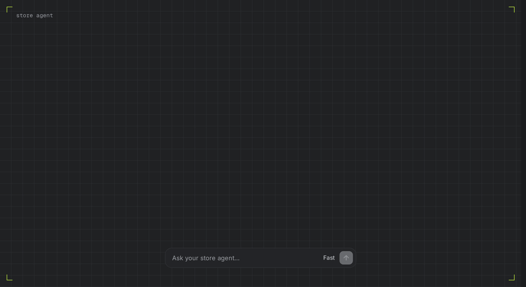
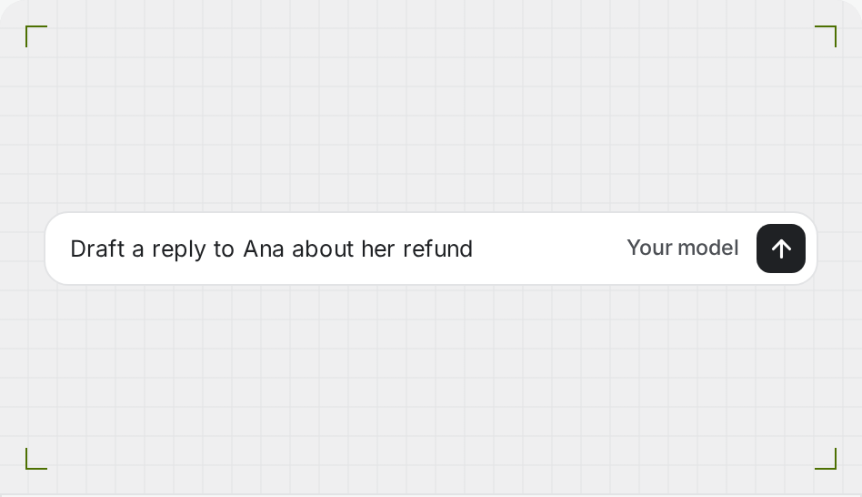
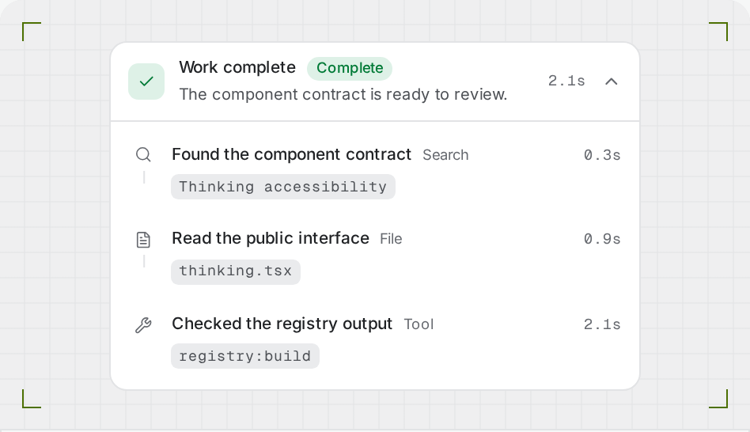
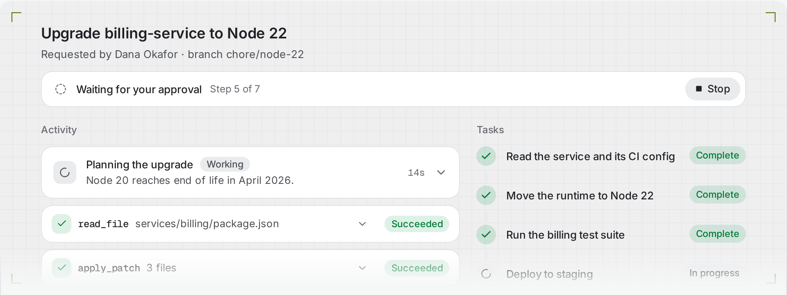
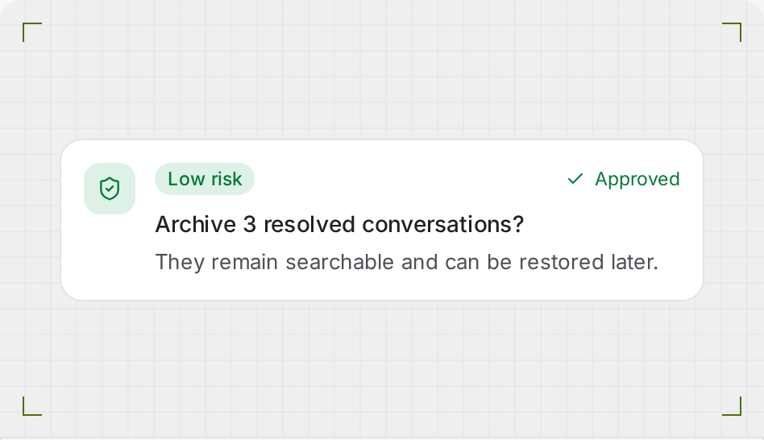
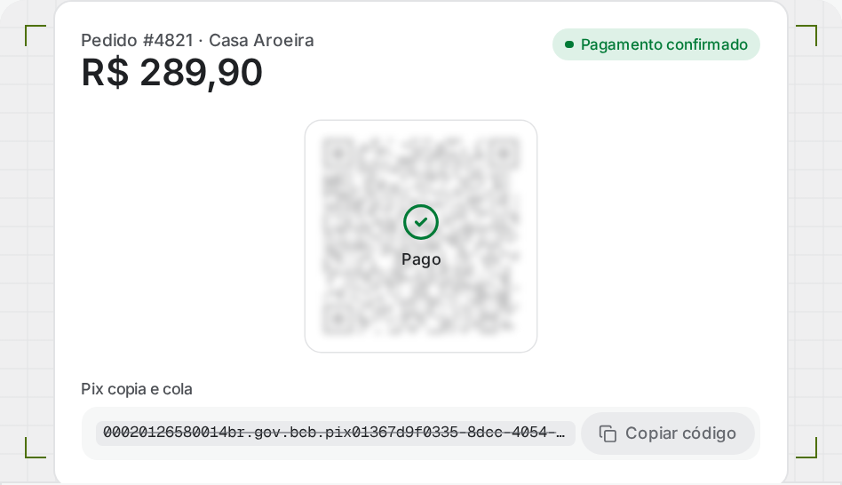
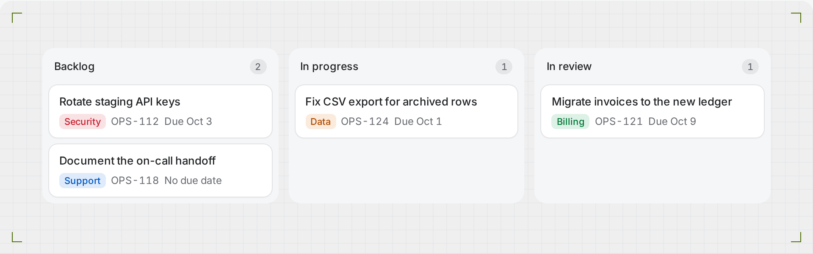
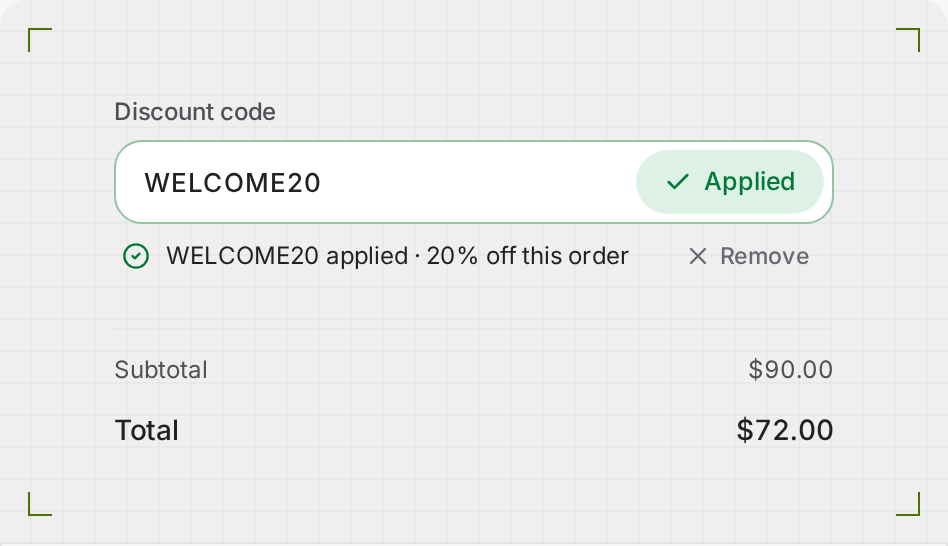
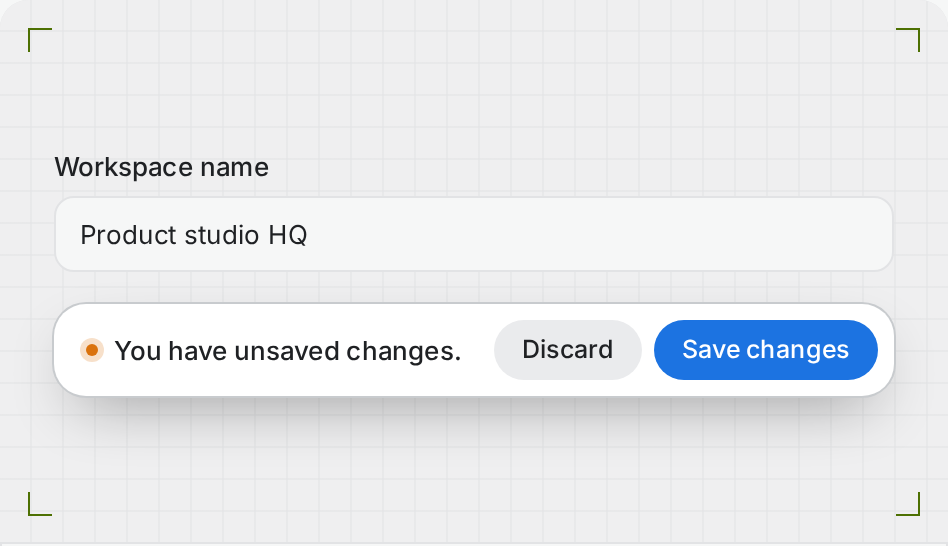

# Uai

Uai is an open-code React component library for websites and web applications.
It works as a shadcn registry: the CLI copies each component and its dependencies
into the consumer's application, where the team can inspect and change every line.

The repository includes a component browser built with Next.js, Fumadocs UI,
Tailwind CSS, and Bun.

<p align="center">
  <a href="https://uaiblocks.vercel.app">
    <picture>
      <source media="(prefers-color-scheme: dark)" srcset=".github/readme/uai-hero-dark.gif">
      <source media="(prefers-color-scheme: light)" srcset=".github/readme/uai-hero-light.gif">
      
    </picture>
  </a>
</p>

```bash
bunx shadcn@latest add https://uaiblocks.vercel.app/r/prompt-composer.json
```

## Best of Uai

<table>
  <tr>
    <td width="50%" valign="top">
      <a href="https://uaiblocks.vercel.app/components/prompt-composer">
        <picture>
          <source media="(prefers-color-scheme: dark)" srcset=".github/readme/tiles/prompt-composer-dark.png">
          
        </picture>
      </a>
      <br><a href="https://uaiblocks.vercel.app/components/prompt-composer"><b>Prompt Composer</b></a> · Forms
      <br><sub>A prompt bar with ghost plus, ink send, and rounded, pill, ghost, and compact variants.</sub>
    </td>
    <td width="50%" valign="top">
      <a href="https://uaiblocks.vercel.app/components/thinking">
        <picture>
          <source media="(prefers-color-scheme: dark)" srcset=".github/readme/tiles/thinking-dark.png">
          
        </picture>
      </a>
      <br><a href="https://uaiblocks.vercel.app/components/thinking"><b>Thinking</b></a> · AI
      <br><sub>A live and inspectable activity disclosure with explicit states and structured evidence.</sub>
    </td>
  </tr>
  <tr>
    <td colspan="2" valign="top">
      <a href="https://uaiblocks.vercel.app/components/agent-run">
        <picture>
          <source media="(prefers-color-scheme: dark)" srcset=".github/readme/tiles/agent-run-dark.png">
          
        </picture>
      </a>
      <br><a href="https://uaiblocks.vercel.app/components/agent-run"><b>Agent Run</b></a> · AI · Block
      <br><sub>Agent thinking and tool calls, task progress, approvals, and a final run summary.</sub>
    </td>
  </tr>
  <tr>
    <td width="50%" valign="top">
      <a href="https://uaiblocks.vercel.app/components/approval-card">
        <picture>
          <source media="(prefers-color-scheme: dark)" srcset=".github/readme/tiles/approval-card-dark.png">
          
        </picture>
      </a>
      <br><a href="https://uaiblocks.vercel.app/components/approval-card"><b>Approval Card</b></a> · Feedback
      <br><sub>A controlled decision surface for reviewing an AI action's risk, evidence, and impact.</sub>
    </td>
    <td width="50%" valign="top">
      <a href="https://uaiblocks.vercel.app/components/pix-payment">
        <picture>
          <source media="(prefers-color-scheme: dark)" srcset=".github/readme/tiles/pix-payment-dark.png">
          
        </picture>
      </a>
      <br><a href="https://uaiblocks.vercel.app/components/pix-payment"><b>Pix Payment</b></a> · Brazil
      <br><sub>A Pix charge with QR code, copy-and-paste code, expiry countdown, and payment status.</sub>
    </td>
  </tr>
  <tr>
    <td colspan="2" valign="top">
      <a href="https://uaiblocks.vercel.app/components/kanban-board">
        <picture>
          <source media="(prefers-color-scheme: dark)" srcset=".github/readme/tiles/kanban-board-dark.png">
          
        </picture>
      </a>
      <br><a href="https://uaiblocks.vercel.app/components/kanban-board"><b>Kanban Board</b></a> · Data Display
      <br><sub>Columns, cards, keyboard movement, and empty states.</sub>
    </td>
  </tr>
  <tr>
    <td width="50%" valign="top">
      <a href="https://uaiblocks.vercel.app/components/coupon-field">
        <picture>
          <source media="(prefers-color-scheme: dark)" srcset=".github/readme/tiles/coupon-field-dark.png">
          
        </picture>
      </a>
      <br><a href="https://uaiblocks.vercel.app/components/coupon-field"><b>Coupon Field</b></a> · Commerce
      <br><sub>A checkout-safe discount field with rounded, pill, and compact variants.</sub>
    </td>
    <td width="50%" valign="top">
      <a href="https://uaiblocks.vercel.app/components/unsaved-changes-bar">
        <picture>
          <source media="(prefers-color-scheme: dark)" srcset=".github/readme/tiles/unsaved-changes-bar-dark.png">
          
        </picture>
      </a>
      <br><a href="https://uaiblocks.vercel.app/components/unsaved-changes-bar"><b>Unsaved Changes Bar</b></a> · Forms
      <br><sub>Persistent save and discard actions with busy, error, and page-exit warnings.</sub>
    </td>
  </tr>
</table>

<p align="center"><a href="https://uaiblocks.vercel.app">Browse all 108 items →</a></p>

## Run the site

Install the dependencies and start the local development server:

```bash
bun install
bun run dev
```

Open `http://localhost:3000` for the overview. Every registry item has its own page
at `/components/<name>`. Press ⌘K or `/` to search. Generated registry documents are
available under `/r`.

For AI tools, `/llms.txt` indexes every item, `/llms-full.txt` holds the full text,
and `/components/<name>.md` serves one item as Markdown with its install command,
usage example, part tree, and accessibility notes. They are generated from the
catalog in `src/lib/llms.ts` with Fumadocs' `llms()` helper.

## Search and share metadata

`src/app/robots.ts` and `src/app/sitemap.ts` serve `/robots.txt` and `/sitemap.xml`;
the sitemap lists the overview, `/theming`, and every `/components/<name>` page.
Every page builds its title, description, canonical URL, and Open Graph and Twitter
tags with `pageMetadata()` in `src/lib/metadata.ts`, against the origin in
`src/lib/site.ts` (the `homepage` in `registry.json`).

Share images are generated by `src/app/opengraph-image.tsx` (site-wide) and
`src/app/(home)/components/[id]/opengraph-image.tsx` (one per item). Both render
`OgTemplate` from `src/components/og/og-template.tsx`; replace that component to
change the design of every share image. Item images show a capture of the live
specimen from `src/assets/og/`. After changing a preview, rebuild, start the site,
and refresh the captures with `bun run og:capture [id ...]` (set `OG_BASE_URL` if
the server is not on port 3100).

## Install a registry item locally

Keep the Uai development server running. In a shadcn project, run:

```bash
bunx shadcn@latest add http://localhost:3000/r/prompt-composer.json
```

Prompt Composer installs the Uai theme, the shared class-name utility, and the
shadcn primitives it composes (`button`, `textarea`, `dropdown-menu`, …) from the
shadcn registry. Replace `prompt-composer` with another registry item name to install that component.

Components are styled with Tailwind classes and the standard shadcn theme tokens
(`background`, `card`, `muted-foreground`, `primary`, …). The `uai-theme` item fills
those tokens with the Uai palette and adds `subtle-foreground`, `border-strong`,
`success`, and `warning`. Entrance motion uses `tw-animate-css`, which `shadcn init`
imports by default. Restyle any part by passing `className`.

Set `NEXT_PUBLIC_REGISTRY_URL` to the deployed `/r` URL before publishing the
site. Update the `homepage` and dependency URLs in `registry.json` at the same
time. shadcn requires full URLs for custom registry dependencies.

## Repository layout

- `src/registry/uai`: source files distributed through the registry.
- `src/components/registry`: site shell, command palette, catalog, previews, and
  install workflow.
- `src/app/(home)/components/[id]`: the statically generated page for each item.
- `src/components/ui/uai`: re-exports of registry components at their install path.
- `src/components/ui`: stock shadcn primitives (new-york, Radix) that registry
  components import. Consumers install their own copies, so never edit these.
- `src/components/uai`: re-exports of registry blocks.
- `registry.json`: the registry catalog and dependency graph.
- `public/r`: generated registry documents.

## Add a component

1. Add the source file under `src/registry/uai/components` or `src/registry/uai/blocks`, and add
   a one-line re-export of it at `src/components/ui/uai` or `src/components/uai`.
2. Define the public item, target path, and dependencies in `registry.json`.
3. Add the catalog entry and live preview in the matching group folder under
   `src/components/registry/<group>`. The entry's `usage` must equal the preview file.
4. Run the validation suite.

See `CONTRIBUTING.md` for the full checklist.

Keep public interfaces small. A compound component should own its shared behavior
and delegate replaceable content to named children.

## Validate a change

```bash
bun run typecheck
bun run lint
bun run registry:check
bun run test
bun run build
bun run test:e2e
```

`bun run test` regenerates the registry before checking its public documents.
`bun run build` does the same before creating the production site. `bun run test:e2e`
screenshots every component page in both themes on desktop and mobile, runs axe, and
checks reduced motion against the production build; run `bun run test:e2e:install` once
first.

## License

[MIT](LICENSE) © 2026 Victor Mesquita
